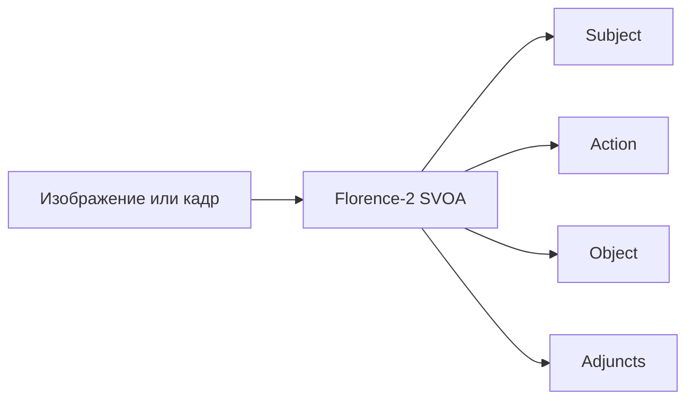
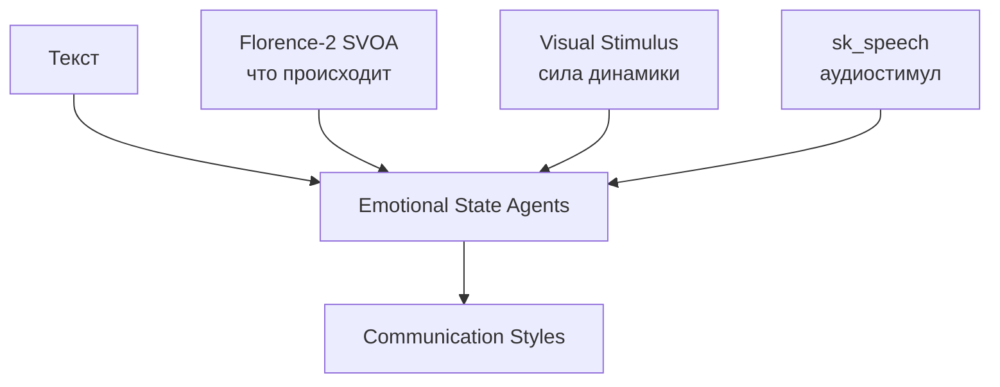

# Florence-2 SVOA

**Структурированное извлечение визуальных событий из изображений и ключевых кадров.**

[English](README_EN.md) · [Формат результата](docs/output-schema.md) · [Датасет](docs/dataset.md) · [Обучение](docs/training.md) · [Оценка](docs/evaluation.md) · [Ограничения](docs/limitations.md)

`florence2-svoa` дообучает Florence-2 преобразовывать изображение в компактное описание непосредственно наблюдаемого события:

```text
subject|action|object|adjuncts
```

Пример:

```text
man|smile|none|skatepark
```

Модель отвечает на вопрос **«что происходит в кадре?»**. Она не распознаёт эмоциональное состояние, не измеряет динамику движения и не заменяет видеомодель. Для видео независимые описания кадров образуют временную последовательность событий.



## Быстрый запуск: четыре команды

Установите зависимости:

```bash
python -m pip install -e ".[all]"
```

Создайте `.env` на основе `.env.example`, затем выполните:

### 1. Скачать изображения и официальные аннотации

```bash
python svoa.py download --limit-per-dataset 5000
```

### 2. Получить итоговый датасет через VLM

```bash
python svoa.py prepare --env-file .env --limit-per-dataset 5000
```

Внутри этой команды автоматически выполняются VLM-разметка, коррекция SWiG и коррекция HaGRID. Итоговый файл:

```text
svoa_work_v2/dataset.jsonl
```

### 3. Обучить Florence-2

```bash
python svoa.py train --output-dir ./florence2_svoa_model
```

Параметры обучения можно дописать к той же команде:

```bash
python svoa.py train \
  --output-dir ./florence2_svoa_model \
  --epochs 30 \
  --batch-size 1 \
  --gradient-accumulation 4
```

### 4. Проверить инференс

```bash
python svoa.py infer \
  --model ./florence2_svoa_model/best_model \
  --image ./example.jpg
```

## Программное использование

```python
from florence2_svoa.inference import Florence2SVOA

model = Florence2SVOA("./florence2_svoa_model/best_model")
result = model.predict("./example.jpg")

if result.valid:
    print(result.event.as_dict())
else:
    print(result.error)
```

## Схема SVOA

| Поле | Значение | Пример |
|---|---|---|
| `subject` | главный видимый участник | `man` |
| `action` | непосредственно наблюдаемое действие или жест | `smile`, `thumb index` |
| `object` | видимая цель действия | `ball`, `none` |
| `adjuncts` | обстоятельство или место | `skatepark` |

`subject`, `object` и `adjuncts` содержат одно слово. `action` может содержать каноническое многословное название жеста HaGRID, например `little finger` или `three gun`. Подробный контракт описан в [docs/output-schema.md](docs/output-schema.md).

## Текущий baseline

Опубликованные ниже результаты относятся к текущему экспериментальному checkpoint, а не к окончательной валидации модели.

| Метрика | Значение |
|---|---:|
| Тестовых примеров | 2 231 |
| Корректный формат | 99,51% |
| Полное совпадение четырёх полей | 27,66% |
| `subject` accuracy | 77,68% |
| `action` accuracy | 63,33% |
| `object` accuracy | 63,65% |
| `adjuncts` accuracy | 57,01% |

Лучший validation loss: `0.45876` на эпохе 8. После неё train loss продолжал снижаться, а validation loss перестал улучшаться — checkpoint эпохи 8 используется как лучший.

Подробности и правила интерпретации метрик: [docs/evaluation.md](docs/evaluation.md).

## Состав репозитория

```text
florence2-svoa/
├── svoa.py                         # публичный CLI: 4 команды
├── src/florence2_svoa/             # схема, парсинг, Python inference
├── scripts/                        # подготовка, коррекция, обучение, диагностика
├── configs/                        # воспроизводимые параметры экспериментов
├── examples/                       # компактные результаты
├── tests/                          # автоматические тесты
└── docs/                           # документация по этапам
```

## Место в системе эмоционального состояния

Florence-2 SVOA — семантическая визуальная ветвь. Она извлекает структуру события. Динамические видеопризнаки — активность, темп и силу отклонения изображения — должен вычислять отдельный компонент.



## Что не хранится в GitHub

- веса модели и промежуточные checkpoint;
- полный набор исходных изображений;
- большие видео;
- API-ключи и локальные пути;
- временные результаты экспериментов.

Веса финальной модели планируется публиковать отдельно на Hugging Face.

## Тесты

```bash
python -m unittest discover -s tests -v
```

## Лицензия

Код распространяется по лицензии [MIT](LICENSE). У базовой модели и исходных датасетов могут быть собственные лицензии и ограничения; перед распространением весов и данных их необходимо проверять отдельно.
